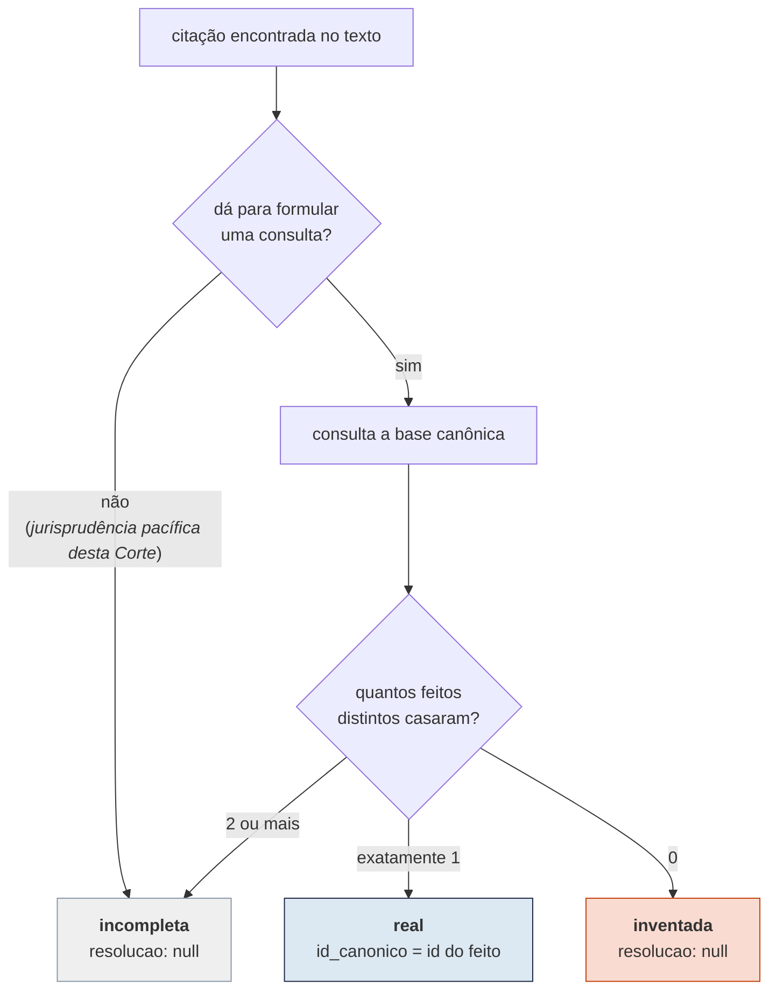
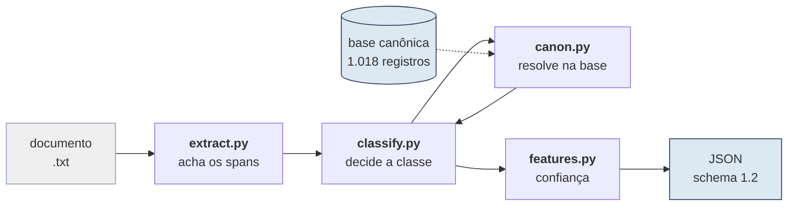
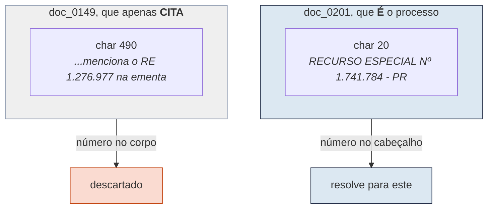
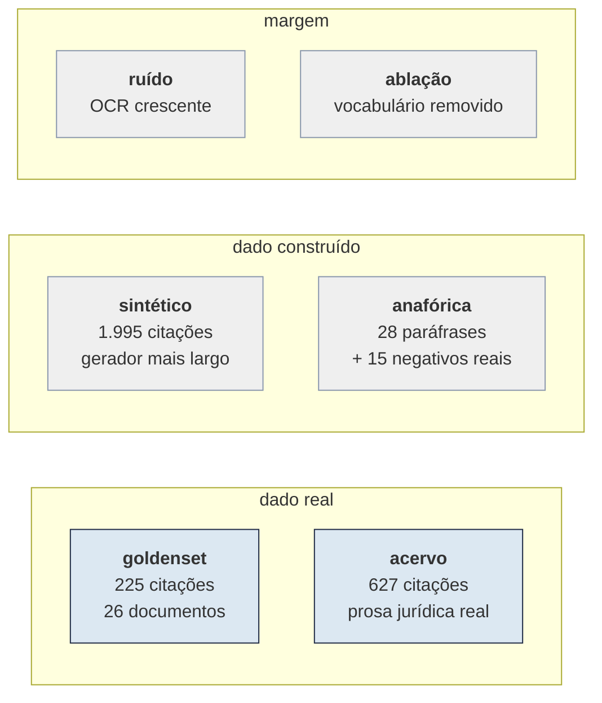

# Caça-Alucinações

Verificador de citações jurídicas para o challenge Jusbrasil × BRACIS 2026.

O sistema lê uma peça jurídica em texto puro, acha cada citação de
jurisprudência e de lei, e decide se ela é verdadeira, inventada ou vaga demais
para ser verificada. Nas verdadeiras, ele também diz qual registro da base
canônica foi citado.

**O que ele não é.** Não é um modelo de linguagem, nem usa um. É um sistema
simbólico: expressões regulares que reconhecem forma jurídica, um índice
construído sobre a base que a organização distribuiu, e a tabela de decisão do
enunciado. Ele não detecta nem previne alucinação; ele verifica citações contra
uma cobertura fechada, e fora dessa cobertura não tem opinião.

---

## Sumário

1. [O problema](#o-problema)
2. [Como rodar](#como-rodar)
3. [Como funciona](#como-funciona)
4. [A armadilha central](#a-armadilha-central-quem-é-o-processo-e-quem-apenas-o-cita)
5. [Resultados](#resultados)
6. [Como isso foi verificado](#como-isso-foi-verificado)
7. [O que ainda é frágil](#o-que-ainda-é-frágil)
8. [Problemas no dataset](#problemas-no-dataset)
9. [Reprodução](#reprodução)

---

## O problema

Modelos de linguagem já escrevem pareceres e petições, e às vezes citam
acórdãos que não existem. O desafio pede o verificador que falta nesse fluxo.

A entrada é um arquivo `.txt` por peça. A saída é um JSON por peça, com uma
entrada por citação: onde ela começa e termina no texto, o trecho literal, se é
lei ou jurisprudência, a classe, e o registro resolvido quando houver.

São três classes, e a diferença entre as duas últimas importa na prática. A
citação **inventada** é alucinação ativa e deve ser bloqueada. A **incompleta**
é evasiva, e serve para sinalizar revisão humana.

A regra de decisão é quase aritmética, uma vez resolvida a consulta:



A base é uma **cobertura congelada** de 1.018 registros, e esse detalhe do
enunciado muda o desenho da solução. Se um acórdão existe no mundo mas não está
ali, para efeito do desafio ele não existe. Isso torna o problema decidível, e
é o que permite resolver por índice em vez de por busca aberta.

---

## Como rodar

```bash
python run.py <pasta_com_os_txt> saida_json --submissao submission.csv
```

`run.py` usa apenas a biblioteca padrão do Python 3.12. Não baixa pesos, não
faz chamada de rede e não pede GPU. Os 26 documentos de desenvolvimento saem em
cerca de 1,2 segundo com 130 MB de memória, bem dentro do envelope de avaliação
do desafio (1 GPU de 24 GB, 8 vCPUs, 32 GB de RAM).

`dados/` é um link simbólico para a pasta do dataset. Para apontar outro banco,
use `--db`.

Para avaliar, um comando roda a bateria inteira:

```bash
python -m venv .venv && .venv/bin/pip install -r requirements.txt
.venv/bin/python verifica.py            # todas as suítes
.venv/bin/python verifica.py --rapido   # só as rápidas, cerca de 15 s
```

Cada suíte também roda sozinha, por exemplo
`python -m avaliacao.metrica --conjunto tudo`.

---

## Como funciona

O caminho de um documento até o JSON tem quatro etapas. Cada uma resolve um
problema diferente, e falham por razões diferentes.



### Extração: ancorar em forma, não em frase

O extrator poderia procurar as frases que os documentos usam para introduzir
citações. Seria fácil e seria frágil, porque a frase é escolha do gerador e a
forma é convenção do direito.

Ele faz o contrário. Acha primeiro os números que parecem processo, depois
pergunta se à esquerda deles há uma classe processual. O reconhecimento da
classe tem duas vias:

- **Lista fechada.** Um inventário de 88 classes processuais conhecidas, de
  `REsp` a `Recurso em Sentido Estrito`.
- **Âncora aberta.** Quando a lista falha, vale um núcleo nominal
  (`Agravo`, `Recurso`, `Embargos`, `Suspensão` e outros vinte) seguido dos seus
  modificadores, ou uma sigla curta colada no número. Uma lista negra descarta
  o que não é processo: `DJe`, `fls.`, `OAB`, `Lei`, `Evento`, siglas de estado
  e numeração de documento administrativo.

A segunda via existe porque a primeira é sempre incompleta. Minerando os 1.018
registros da base aparecem classes reais que nenhum dos 26 documentos de
desenvolvimento usa: `APM` com 1.898 ocorrências, `IPM` com 890, além de
`IRDR`, `EAREsp` e `RRAg`. A [Figura 2](#robustez) mostra o quanto isso importa.

O ruído do nível 2 troca letra por dígito dentro do identificador, e o
enunciado garante que dígito nunca vira outro dígito. O extrator aceita essas
letras dentro do número e expande as leituras possíveis na hora de consultar.

### Índice canônico: um feito, vários registros

Um **feito** é um processo, identificado pelo par (número normalizado,
tribunal). Um mesmo feito pode ter mais de um registro no acervo, por exemplo
quando há embargos de declaração sobre a mesma decisão. Por isso o índice
guarda uma lista, não um registro só.

O número de cada acórdão sai do seu **cabeçalho**, com um leitor por tribunal.
No TST a âncora não é o cabeçalho e sim a linha de autuação, aquela que diz
`estes autos de ... nº TST-..., em que é Agravante`, porque é ali que mora o
número do próprio feito.

Leis e súmulas não resolvem por número de processo. Os 18 registros de súmula e
dispositivo existem para isso, e são casados por texto normalizado do diploma.

### Confiança: uma constante, e isso foi medido

O desafio dá até 10% de bônus para quem envia `confianca` bem calibrada,
pontuada por **Brier score**, uma medida de erro em que zero é perfeito e
valores menores são melhores.

Chegamos a treinar uma regressão logística sobre features do próprio processo
de decisão: quantos feitos casaram, se a pista de tribunal confirmou, quanto
ruído de OCR havia no span, qual âncora disparou. Ela ficava excelente no
conjunto de treino. No dado real, perdia para uma constante.

| estratégia | Brier no goldenset |
|---|---|
| **constante igual à acurácia** | **0,02976** |
| regressão logística | 0,03023 |
| taxa por classe | 0,03039 |
| taxa por forma | 0,03069 |
| taxa por forma e classe | 0,03072 |

A causa não se resolve com mais dados sintéticos. São 7 erros em 228 predições
reais, e com essa quantidade não há sinal para ajustar nada mais fino que uma
constante. A confiança nos erros era 0,985 contra 0,969 na média geral, ou
seja, o modelo não distinguia acerto de erro.

`ferramentas/confianca.py` roda essa comparação por validação cruzada agrupada por
documento e grava a vencedora. Hoje grava a acurácia medida menos um ponto de
margem, porque errar por excesso de confiança custa mais no Brier do que errar
por falta. Se aparecer mais dado real rotulado, basta rodar de novo: o script
se recusa a gravar a constante caso algum modelo passe a ganhar.

---

## A armadilha central: quem é o processo e quem apenas o cita

Esta é a parte do desafio que mais custa precisão, e o enunciado avisa sobre
ela. Acórdãos citam uns aos outros o tempo todo. Uma busca por texto integral
pelo número `1.276.977` devolve seis documentos do STF, e nenhum deles é o RE
1.276.977. Todos apenas o citam.

O sinal que separa os dois casos é a posição do número dentro do documento:



Essa armadilha nos pegou uma vez, e de um jeito instrutivo. Quando o índice de
cabeçalho não acha o número, uma rede de segurança consulta o índice de texto
integral. A primeira versão aceitava qualquer número que aparecesse nos
primeiros 700 caracteres do documento. Só que a ementa começa logo depois do
cabeçalho e cita outros processos: `doc_0005` é a *AG.REG. NA RECLAMAÇÃO
66.755* e menciona o RE 958.252 no caractere 644, dentro da janela.

A rede foi endurecida. No STF, STJ e TSE, o número precisa ser o **primeiro**
número de processo do documento. No TST e no STM, precisa estar junto da linha
de autuação. O custo é conhecido e foi aceito de propósito: sabotando o leitor
de cabeçalho, com metade dos registros quebrados a recuperação cai de 92,5%
para 64,5%. Uma citação `real` falsa é o erro mais caro da métrica, e o leitor
de cabeçalho hoje não tem falha alguma, então a rede protege contra um problema
hipotético enquanto o falso positivo era um problema demonstrado.

---

## Resultados

A métrica oficial é F1 macro por classe, calculada por nível de dificuldade. F1
combina precisão e recall numa medida em que 1 é perfeito. Macro significa que
as três classes pesam igual, independentemente de quantas citações cada uma
tem. O nível 2, mais ruidoso, pesa o dobro do nível 1.

**Tabela 1.** F1 por classe no goldenset distribuído, 225 citações em 26 documentos.

| nível | real | inventada | incompleta | **macro** |
|---|---|---|---|---|
| 1 (peso 1×) | 0,981 | **1,000** | 0,985 | **0,9885** |
| 2 (peso 2×) | 0,932 | **1,000** | 0,971 | **0,9675** |
| **ponderado** | | | | **0,9745** |

O número que mais importa nessa tabela é o do meio. A classe `inventada` sai
com F1 igual a 1,000 nos dois níveis, e **nenhuma alucinação foi classificada
como real**. Isso não é sorte: `inventada` só é emitida quando a busca retorna
zero resultados, e não existe caminho no código que promova uma `inventada` a
`real`. Se a métrica pune em dobro esse erro, como o enunciado indica, a
penalidade nunca dispara.

O elo mais fraco é `real` no nível 2, com F1 de 0,932. Os erros que o produzem
estão todos explicados na seção [Problemas no dataset](#problemas-no-dataset).

### Robustez

Os 26 documentos distribuídos são uma amostra pequena, e a nota oficial vem de
um conjunto que não vimos. Duas medições estimam a margem.

<a name="robustez"></a>

|  |  |
|---|---|

**Figura 2.** À esquerda, o escore conforme o ruído de OCR aumenta; a linha
vermelha marca a taxa que os documentos de nível 2 realmente têm. À direita, o
escore conforme entradas do vocabulário de classe são removidas ao acaso.

A curva da esquerda diz que o sistema opera perto do seu ponto de conforto. Os
documentos de nível 2 têm cerca de 0,4% dos caracteres corrompidos, e nessa
faixa o escore fica em 95,1%. Dobrar o ruído custa meio ponto; multiplicá-lo
por dez custa treze pontos.

Quanto do resultado depende de a lista de classes ter sido escrita certa? É o
que a curva da direita responde. A linha tracejada é a
versão que tinha só a lista fechada. Remover metade das 88 entradas custava
15,7 pontos. Com a âncora aberta, a mesma remoção custa 1,4 ponto. É a
diferença entre um sistema que depende do inventário escrito à mão e um que
depende do formato.

---

## Como isso foi verificado

Nenhuma suíte sozinha diz se a solução vai bem no conjunto cego. Juntas, elas
cercam o problema pelos lados que ele tem.



**Tabela 2.** Resultado em cada superfície.

| superfície | tamanho | resultado |
|---|---|---|
| goldenset | 225 citações | 97,9% ponderado, recall de span 99,1%, precisão 97,8% |
| acervo real | 627 citações | 100% de span, 100% de link |
| auditoria independente | 67 citações, 5 tribunais | 100% pelo oráculo de posição, 94% pelo de frequência |
| sintético, semente inédita | 1.995 citações | 99,2% ponderado, precisão 100% |
| paráfrases anafóricas | 28 positivos, 15 negativos | 96% de recall, 100% de precisão |
| ruído de OCR no nível real | 0,5% dos caracteres | 95,1% ponderado |
| metade do vocabulário removida | 44 das 88 entradas | 96,5% ponderado |

### O goldenset, e o overfit que ele escondia

Os 26 documentos foram divididos em dois: `*_001` a `*_007` para desenvolver,
`*_008` a `*_013` guardados. As regras foram escritas olhando só a primeira
metade.

A primeira medição na metade guardada deu 75,2%, contra 96,0% na metade de
desenvolvimento. Vinte e um pontos de diferença é overfit, e foi assim que
soubemos. A distância caiu para cerca de dois pontos quando as correções
passaram a ser de cobertura de forma, e não remendo de caso.

### O acervo como conjunto de teste, sem custo de anotação

Os 1.018 registros da base contêm milhares de citações reais, em prosa jurídica
de verdade e não sintética. Ninguém precisa anotá-las: toda ocorrência, no
corpo de um acórdão, de um número que resolve para outro feito do acervo é uma
citação inegável. São 627, quase três vezes o goldenset inteiro.

Essa suíte pagou. Ela achou quatro lacunas que 26 documentos sintéticos nunca
mostrariam: listas enumeradas do tipo `Rcls 60.699 e 60.703`, onde uma classe
governa vários números e só o primeiro a tem à esquerda; sufixo de recurso
colado no número, como `55.624-AgR/RO`; `Processo nº <CNJ>` no corpo, que o
enunciado manda tratar como citação e o extrator só tratava como distrator de
cabeçalho; e nome de classe entre aspas, parênteses ou barra.

### A auditoria independente, e por que a outra não bastava

A conferência de link embutida no `avaliacao/acervo.py` chama o mesmo leitor de
cabeçalho que constrói o índice. Isso a torna **circular**: se o leitor erra,
auditor e resolvedor erram igual, e o teste reporta acerto. Ela valida
consistência, não correção, e está marcada como tal no código.

`avaliacao/auditoria.py` usa dois critérios que não passam pelo leitor, e que
falham por razões diferentes.

- **Posição.** Quem é o processo carrega o número mais cedo; quem apenas cita o
  traz no corpo. É forte no STF, no STJ e no TSE, onde o número está no
  cabeçalho, e fraco no TST e no STM, onde a linha de autuação pode estar a
  milhares de caracteres do início.
- **Frequência.** Quem é o processo repete o próprio número, no cabeçalho, na
  autuação e no rodapé; quem apenas cita costuma mencionar uma vez. Não depende
  de posição, então não herda a fraqueza do primeiro.

A amostra é estratificada por tribunal, porque uma amostra aleatória concentra
STF e STJ e deixa o TST e o STM, justamente onde o oráculo de posição é fraco,
com poucos casos ou nenhum.

**Tabela 3.** Concordância entre o resolvedor e cada oráculo, por tribunal.

| tribunal | n | posição | frequência |
|---|---|---|---|
| STF | 15 | 100% | 100% |
| STJ | 15 | 100% | 73% |
| STM | 15 | 100% | 100% |
| TSE | 15 | 100% | 100% |
| TST | 7 | 100% | 100% |
| **total** | **67** | **100%** | **94%** |

O oráculo de posição concorda em todos os cinco tribunais, inclusive nos dois
onde se esperava que fosse fraco. Onde o de frequência discorda, a inspeção
mostra que o errado é ele: no caso do número 1377019, o resolvedor aponta um
documento que traz o número na posição 20, que só pode ser cabeçalho, enquanto
o oráculo de frequência prefere outro que o menciona mais vezes no corpo.

Na primeira rodada essa segunda leitura discordou em 80% dos casos. Os dois
lados tinham defeito. No sistema, era a janela frouxa da rede de segurança,
descrita na seção da armadilha. No auditor, era contar **empate** como
divergência: quando dois registros do mesmo feito aparecem na mesma posição, o
enunciado diz que acertar qualquer um conta como acerto pleno. Corrigidos os
dois, a concordância é de 150 em 150.

### O gerador próprio, feito mais largo que o deles

`ferramentas/gerador.py` reconstrói a peça sintética de propósito mais ampla que a
original: classes vindas da mineração do acervo, formatos de número e de estado
combinados livremente, frases escritas fora do inventário observado, ruído
ajustável. O gabarito é exato porque os spans são colocados, não anotados.

Passar aqui significa cobrir a forma. O que ele não pode fazer é prever o
escore no conjunto cego, porque testa contra o nosso modelo do gerador e não
contra o deles.

### A família mais frágil, testada sem circularidade

A citação sem identificador é a única que o conjunto sintético **não** consegue
medir. As frases anafóricas do gerador foram copiadas do gabarito observado, o
que tornaria o teste circular.

`avaliacao/anaforica.py` resolve isso com duas populações independentes. Os
positivos são 28 paráfrases escritas de propósito fora do vocabulário da regra.
Os negativos são 15 frases reais dos 26 documentos que o gabarito não anota, e
por isso um falso positivo ali é comprovado e não suposto.

A primeira medição deu 50% de recall. Investigar essa lacuna rendeu quatro
bugs, nenhum deles visível no goldenset:

- `diretrizes?` nunca casava a palavra `diretriz`, porque o opcional caiu na
  letra errada.
- O sufixo de gerúndio marcava substantivo como verbo, o que descartava
  `comando`, `bando` e `quando`.
- `esta` sem acento é demonstrativo, não verbo. Como a vista de busca remove
  acentos, `por esta Casa` e `desta Corte`, que são as âncoras mais comuns do
  jargão jurídico, eram lidas como oração e descartadas.
- Um sintagma externo rejeitado escondia um interno válido, porque a varredura
  não sobrepõe: `A tese encontra respaldo em a diretriz jurisprudencial
  predominante` engolia `diretriz jurisprudencial predominante` e perdia os
  dois.

Depois das correções, o recall é de 96% e os 15 negativos continuam limpos.

---

## Isolamento por documento

O conjunto de teste é processado em lote, sem ninguém por perto. Um arquivo com
codificação estranha não pode custar o lote inteiro.

Testamos com 27 arquivos, um deles com um byte inválido. Antes do conserto
saíam 13 JSONs e nenhum `submission.csv`, e como o arquivo ruim ordenava antes
dos `gen_n2_*`, perdia-se justamente o nível 2, que pesa o dobro. Depois do
conserto saem 27 JSONs e o CSV completo, com aviso no `stderr`.

O `--submissao` também não depende mais do link `dados/` existir. Sem o
conversor do organizador, o mesmo CSV é escrito internamente.

---

## O que ainda é frágil

- **A referência sem identificador.** São 96% de recall em fraseados inéditos,
  contra 100% no goldenset, e ela responde por três dos cinco falsos positivos
  que sobram. `precedentes aplicáveis à espécie` é, na superfície, idêntico a
  `verbete sumular aplicável à espécie`, que o gabarito conta como citação. Sob
  F1 macro essa classe vale um terço da nota, então é onde cada ponto rende
  mais.
- **O desempate entre registros do mesmo feito.** O enunciado diz que
  `id_canonico` é um conjunto e que acertar qualquer id conta. Na prática, 4 das
  96 citações `real` caem num feito com mais registros do que o gabarito
  aceita, inclusive um par com texto idêntico byte a byte, onde não existe
  sinal. Adotamos ordem determinística pelo maior `documento_id`. Ela acerta
  nos dois casos observados, o que com dois casos não é evidência de nada.
- **O diploma real fora da cobertura.** Um artigo que existe, de um código que
  não está entre os 18 registros, é classificado como `inventada`. O gabarito
  de desenvolvimento não contém nenhum caso assim, então essa escolha é uma
  aposta e não uma inferência. O enunciado sugere que tal caso sairia do
  scoring, o que mantém o risco baixo.
- **O viés de auto-avaliação.** Duas das evidências deste documento são medidas
  por populações que excluem parte do modo de falha. A conferência de link do
  `avaliacao/acervo.py` usa o mesmo leitor que audita, e por isso existe a
  auditoria independente. O conjunto sintético testa contra o nosso modelo do
  gerador, não contra o deles. As duas ressalvas estão anotadas onde os números
  aparecem.
- **A métrica oficial ainda não foi lida na fonte.** Tudo aqui é medido contra
  um proxy montado a partir do enunciado. O `kaggle_metric.py` citado no PDF não
  veio no pacote de dados, e o validador de formato do starter kit também não.

---

## Problemas no dataset

Três achados que valem uma pergunta à organização. Os dois primeiros afetam a
nota de qualquer competidor, não só a nossa.

**1. `gen_n2_010.txt` não bate com o gabarito.** O arquivo distribuído perdeu a
string `"AgInt no "`, que tem exatamente 9 caracteres, antes da citação `g2`.
Por isso `g2` não é localizável no texto e as citações `g3` a `g7` estão
deslocadas em 9 posições. São 6 das 225 citações, e nenhuma solução consegue
alinhá-las. Nos outros 25 documentos, os 218 spans restantes batem no offset
exato, o que mostra que o problema é desse arquivo e não uma convenção.

**2. Duas citações `real` apontam para quem cita, não para quem é.** Em
`gen_n2_005/g6`, a citação `TST-AgARR-25823-78.2015.5.24.0091` tem
`id_canonico = 2813052232`, que é o `doc_0710`. O número próprio do `doc_0710`,
na sua linha de autuação, é `TST-Ag-ARR-10132-34.2015.5.03.0018`. Quem é o
AIRR-25823 é o `doc_0729`. O mesmo ocorre em `gen_n1_012`. Se o gabarito do
conjunto cego foi gerado pelo mesmo processo, isso muda a estratégia de
desempate, e essa é uma resposta que só a organização pode dar.

**3. Dois artefatos citados nas regras não vieram.** O `kaggle_metric.py`, que
o PDF diz acompanhar os dados, e o starter kit com o validador de formato, que
o site manda rodar antes de submeter.

---

## Reprodução

O sistema é determinístico por construção. Não há modelo, amostragem nem
semente: a mesma entrada produz a mesma saída, byte a byte.

O comando exato que gera as predições submetidas está em
[`REPRODUZIR.md`](REPRODUZIR.md), junto com o `Dockerfile` e o envelope de
execução. Referência de modelo: nenhum.

### Mapa do repositório

O repositório separa três coisas que mudam por razões diferentes: a solução, a
medição da solução, e as ferramentas que produzem insumos para as duas.

```
run.py                    entrada da submissão, só biblioteca padrão
verifica.py               roda a bateria inteira

cacador/                  A SOLUÇÃO
  extract.py                acha os spans de citação
  canon.py                  índice da base canônica
  classify.py               tabela de decisão do enunciado
  features.py               features da confiança
  normalize.py              normalização de identificadores
  pipeline.py               documento para JSON
  calibracao.py             gerado por ferramentas/confianca.py

avaliacao/                COMO SABEMOS QUE ELA FUNCIONA
  metrica.py                alinhamento por IoU e escore  (CLI: goldenset)
  amostragem.py             amostras rotuladas e ajuste logístico
  acervo.py                 teste em escala no acervo real
  auditoria.py              segunda leitura, sem o leitor de cabeçalho
  sintetico.py              escore no conjunto sintético
  anaforica.py              teste da família sem identificador
  ruido.py                  curva de ruído de OCR
  ablacao.py                curva de ablação de vocabulário
  spans.py                  lista spans perdidos e inventados

ferramentas/              INSUMOS
  gerador.py                gera peças sintéticas com gabarito exato
  confianca.py              decide como emitir a confiança
  figuras.py                mede e redesenha os gráficos deste documento
```

Duas regras de dependência valem aqui. Nenhum script importa de outro script:
o que era compartilhado virou `avaliacao/metrica.py` e
`avaliacao/amostragem.py`. E `cacador/` não importa nada de `avaliacao/` nem de
`ferramentas/`, de modo que a submissão não arrasta a infraestrutura de teste.

---

Este documento e o código foram escritos com auxílio de IA generativa para
redação e revisão. As decisões de projeto, as medições e a responsabilidade
pelo conteúdo são dos autores.
