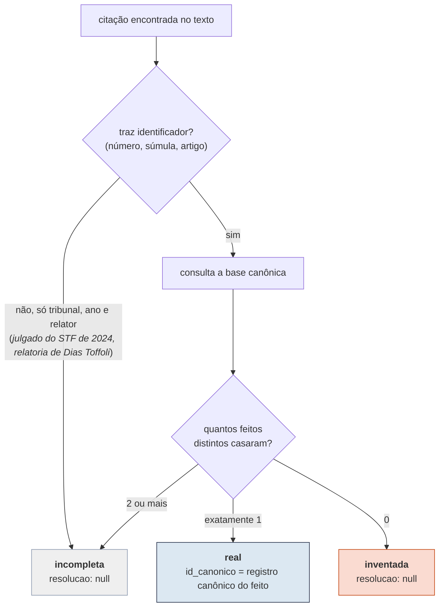
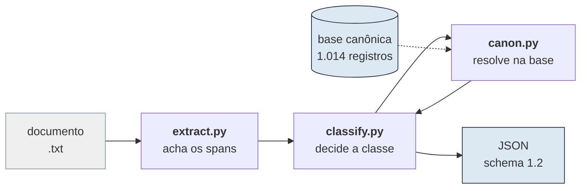
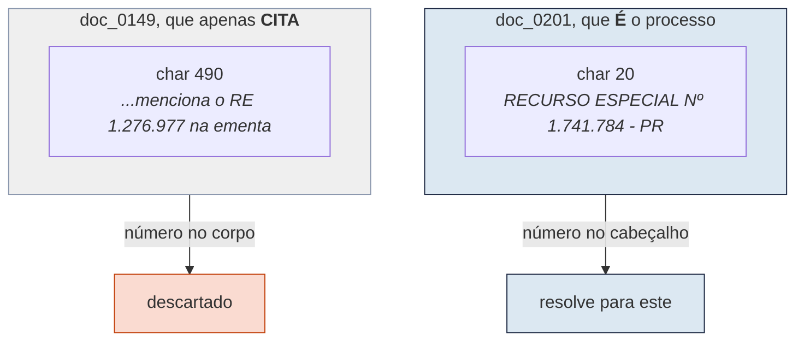
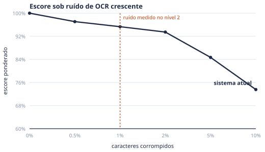
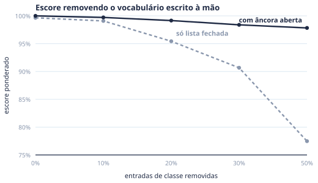
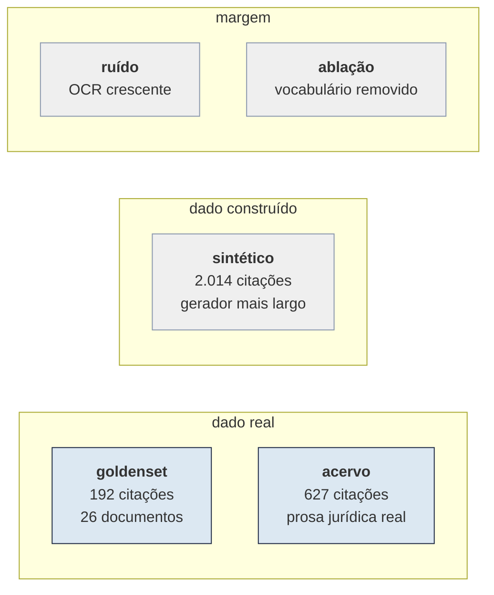

# BaqueanoJus

Verificador de citações jurídicas para o challenge Jusbrasil × BRACIS 2026.

O nome vem do **baqueano**, o guia que conhece o terreno e chega ao destino sem
trilha marcada, que é o que o resolvedor faz com uma referência mal escrita.

O sistema lê uma peça jurídica em texto puro, acha cada citação de
jurisprudência e de lei, e decide se ela é verdadeira, inventada ou vaga demais
para ser verificada. Nas verdadeiras, ele também diz qual registro da base
canônica foi citado.

**O que ele não é.** Não é um modelo de linguagem, nem usa um. É um sistema
simbólico: expressões regulares que reconhecem forma jurídica, um índice
construído sobre a base que a organização distribuiu, e a tabela de decisão do
enunciado. Ele não detecta nem previne alucinação; ele verifica citações contra
uma cobertura fechada, e fora dessa cobertura não tem opinião.

---

## Sumário

1. [O problema](#o-problema)
2. [Como rodar](#como-rodar)
3. [Como funciona](#como-funciona)
4. [A armadilha central](#a-armadilha-central-quem-é-o-processo-e-quem-apenas-o-cita)
5. [Resultados](#resultados)
6. [Como isso foi verificado](#como-isso-foi-verificado)
7. [O que ainda é frágil](#o-que-ainda-é-frágil)
8. [Problemas no dataset](#problemas-no-dataset)
9. [Reprodução](#reprodução)

---

## O problema

Modelos de linguagem já escrevem pareceres e petições, e às vezes citam
acórdãos que não existem. O desafio pede o verificador que falta nesse fluxo.

A entrada é um arquivo `.txt` por peça. A saída é um JSON por peça, com uma
entrada por citação: onde ela começa e termina no texto, o trecho literal, se é
lei ou jurisprudência, a classe, e o registro resolvido quando houver.

São três classes, e a diferença entre as duas últimas importa na prática. A
citação **inventada** é alucinação ativa e deve ser bloqueada. A **incompleta**
aponta uma decisão concreta, com tribunal, ano e relator, mas não traz dado
suficiente para chegar a um registro único, e serve para sinalizar revisão
humana.

A regra de decisão é quase aritmética, uma vez resolvida a consulta:



Referência que não aponta decisão nenhuma, do tipo *jurisprudência pacífica
desta Corte*, não é citação: a organização a tirou do gabarito em 04/09 e em
15/09, e o verificador não a extrai.

A base é uma **cobertura congelada** de 1.014 registros (996 acórdãos, 13
dispositivos de lei e 5 súmulas), e esse detalhe do enunciado muda o desenho da
solução. Se um acórdão existe no mundo mas não está ali, para efeito do desafio
ele não existe. Isso torna o problema decidível, e é o que permite resolver por
índice em vez de por busca aberta.

---

## Como rodar

O ponto de entrada da avaliação final recebe a base, a pasta dos `.txt` e o
arquivo de saída. Os dois comandos abaixo aceitam os mesmos argumentos e dão a
mesma saída, byte a byte:

```bash
bash run.sh        <caminho_db> <pasta_txt> submission.csv   # Python 3.12 da máquina
bash run_docker.sh <caminho_db> <pasta_txt> submission.csv   # o mesmo, no container
```

O `run_docker.sh` constrói a imagem do `Dockerfile` na primeira vez, monta os
caminhos sozinho e roda sem rede.

Ele escreve o `submission.csv` e, em `submission_json/`, o JSON completo de
cada documento, com todos os campos do contrato. Por baixo ele chama o
`run.py`, que também roda direto:

```bash
python run.py --db <caminho_db> --input <pasta_txt> --output saida_json --submissao submission.csv
```

`run.py` usa apenas a biblioteca padrão do Python 3.12: foi testado com o
interpretador do sistema, sem pandas nem numpy instalados. Não baixa pesos, não
faz chamada de rede e não pede GPU. Os 26 documentos de desenvolvimento saem em
1,2 segundo com 130 MB de memória, num Ryzen 5 8600G, bem dentro do envelope de
avaliação do desafio (1 GPU de 24 GB, 8 vCPUs, 32 GB de RAM).

Sem `--db`, a base é procurada dentro da pasta de entrada ou ao lado dela,
depois em `/data` e por fim em `dados/`, pelo nome `desafio1_bracis.db` ou como
único `.db` da pasta. `dados/` fica fora do git e guarda o pacote
do Kaggle como veio, extraído de
`kaggle competitions download desafio-jusbrasil-bracis-2026`.

Para avaliar, um comando roda a bateria inteira:

```bash
python -m venv .venv && .venv/bin/pip install -r requirements.txt
.venv/bin/python verifica.py            # todas as suítes, cerca de 7 min
.venv/bin/python verifica.py --rapido   # só as rápidas
```

Cada suíte também roda sozinha, por exemplo
`python -m avaliacao.metrica --conjunto tudo`.

---

## Como funciona

O caminho de um documento até o JSON tem três etapas. Cada uma resolve um
problema diferente, e falham por razões diferentes.



### Extração: ancorar em forma, não em frase

O extrator poderia procurar as frases que os documentos usam para introduzir
citações. Seria fácil e seria frágil, porque a frase é escolha do gerador e a
forma é convenção do direito.

Ele faz o contrário. Acha primeiro os números que parecem processo, depois
pergunta se à esquerda deles há uma classe processual. O reconhecimento da
classe tem duas vias:

- **Lista fechada.** Um inventário de 86 classes processuais conhecidas, de
  `REsp` a `Recurso em Sentido Estrito`.
- **Âncora aberta.** Quando a lista falha, vale um núcleo nominal
  (`Agravo`, `Recurso`, `Embargos`, `Suspensão` e outros vinte) seguido dos seus
  modificadores, ou uma sigla curta colada no número. Uma lista negra descarta
  o que não é processo: `DJe`, `fls.`, `OAB`, `Lei`, `Evento`, siglas de estado
  e numeração de documento administrativo.

A segunda via existe porque a primeira é sempre incompleta. No acervo aparecem
classes reais que nenhum dos 26 documentos de desenvolvimento usa: contando a
sigla como palavra, `APM` ocorre 2.498 vezes, `IPM` 1.705, `IRDR` 732, `RRAg`
254 e `EAREsp` 169. A [Figura 2](#robustez) mostra o quanto isso importa.

O ruído do nível 2 põe dígito dentro de palavra (`RE5p`, `Eleit0ral`) e letra
dentro de número (`2O24`, `l760`), e o enunciado garante que dígito nunca vira
outro dígito. Por isso todo padrão casa numa **vista** do texto em que a
confusão já foi desfeita, e todo span é cortado do texto original; a vista tem
o mesmo comprimento, então as posições valem nos dois. Em cada palavra, a
maioria decide se ela é de letras ou um número, e só a troca isolada é
desfeita, na direção certa. Código de verdade, com letras e dígitos em bloco
(`QSCON2018`, a inscrição `SP399990`), fica como está. As classes processuais
casam numa vista que mantém o acento, porque sem ele `Ré` viraria `RE` e `pág.`
viraria `Ag`.

### Índice canônico: um feito, vários registros

Um **feito** é um processo, identificado pelo par (número normalizado,
tribunal). Um mesmo feito pode ter mais de um registro no acervo, por exemplo o
recurso especial e os embargos de divergência opostos nele. Por isso o índice
guarda uma lista, e o registro emitido sai de dois critérios, nessa ordem: a
classe processual escrita na citação casada com a do cabeçalho de cada
registro, e, se ainda empatar, a transcrição mais completa (a de texto mais
longo), porque o acervo chegou a ter o mesmo acórdão extraído duas vezes, uma
delas perdendo acentos e trechos curtos.

O número de cada acórdão sai do seu **cabeçalho**, com um leitor por tribunal.
No TST a âncora não é o cabeçalho e sim a linha de autuação, aquela que diz
`estes autos de ... nº TST-..., em que é Agravante`, porque é ali que mora o
número do próprio feito.

Leis e súmulas não resolvem por número de processo. Os registros de súmula e
dispositivo existem para isso, e são casados por texto normalizado do diploma.
O índice deles sai da primeira linha de cada registro (*Artigo 373 da Lei nº
13.105, de 16 de março de 2015*, *Súmula n. 83 do STJ*), e não de uma lista de
ids, porque a base da avaliação final é outra. A lei citada pelo número cai no
código dela: *art. 373 da Lei nº 13.105/2015* e *art. 373 do CPC* resolvem para
o mesmo registro. Registro cuja primeira linha não se lê, ou acórdão de
tribunal sem leitor de cabeçalho próprio, vira aviso no `stderr`, e o lote
segue.

### Confiança: uma constante, e por que é 1,0

A métrica oficial dá até 10% de bônus por `confianca` bem calibrada:
`score = macro-F1 × (1 + 0,10 × (1 − Brier))`, com o **Brier score** calculado
só sobre as citações alinhadas ao gabarito. Brier é o erro quadrático entre a
confiança declarada e o acerto, em que zero é perfeito.

Emitimos uma constante. Nas versões anteriores do gabarito, com cinco a sete
erros entre as predições, comparamos a constante com regressão logística, taxa
por classe e taxa por forma, por validação cruzada agrupada por documento, e
nenhuma venceu a constante com folga num bootstrap por documento. No gabarito
final não há erro nenhum, então não sobra sinal para ajustar.

O valor é 1,0, e não a acurácia menos uma margem, por uma conta simples. Com
constante `c` e acurácia `a` entre os pares alinhados, Brier = a(1 − c)² +
(1 − a)c², e emitir 1,0 empata com emitir 0,99 em a = 0,995. Em 200 documentos
do gerador próprio com a taxa de ruído que os documentos reais têm, a acurácia
entre pares alinhados é de 99,75% (1.988 de 1.993), acima desse ponto. Os erros
que custam precisão no nível 2 são span perdido e falso positivo, e esses não
entram no Brier. A margem é estreita dos dois lados: com 3,5% de ruído a
acurácia cai para 99,3%, e aí 0,99 passaria a ganhar, por quatro milionésimos
de bônus.

`ferramentas/confianca.py` refaz a comparação e grava `baqueano/calibracao.py`;
rodado sem argumentos, reproduz a constante submetida.

---

## A armadilha central: quem é o processo e quem apenas o cita

Esta é a parte do desafio que mais custa precisão, e o enunciado avisa sobre
ela. Acórdãos citam uns aos outros o tempo todo. Uma busca por texto integral
pelo número `1.276.977` devolve seis documentos do STF, e nenhum deles é o RE
1.276.977. Todos apenas o citam.

O sinal que separa os dois casos é a posição do número dentro do documento:



Essa armadilha nos pegou uma vez, e de um jeito instrutivo. Quando o índice de
cabeçalho não acha o número, uma rede de segurança consulta o índice de texto
integral. A primeira versão aceitava qualquer número que aparecesse nos
primeiros 700 caracteres do documento. Só que a ementa começa logo depois do
cabeçalho e cita outros processos: `doc_0005` é a *AG.REG. NA RECLAMAÇÃO
66.755* e menciona o RE 958.252 no caractere 644, dentro da janela.

A rede foi endurecida. No STF, STJ e TSE, o número precisa ser o **primeiro**
número de processo do documento. No TST e no STM, precisa estar junto da linha
de autuação. Hoje ela não muda nada nas medições: foi chamada 512 vezes nos 226
documentos com gabarito, sempre para citações que o índice não achou, e não
resolveu nenhuma; nas 627 citações reais do acervo nem chega a ser chamada.
Fica porque não dá para provar que é redundante para citações ainda não vistas.

---

## Resultados

A métrica oficial, `kaggle_metric.py`, tem quatro passos: F1 macro das três
classes por nível, com `real` exigindo o `id_canonico` certo; uma penalidade
para `inventada` classificada como `real`; o bônus de calibração; e a média dos
níveis, com o nível 2, mais ruidoso, pesando o dobro. F1 combina precisão e
recall numa medida em que 1 é perfeito, e macro significa que as três classes
pesam igual.

**Tabela 1.** Métrica oficial no goldenset final, 192 citações em 26 documentos.

| nível | real | inventada | incompleta | **macro** | bônus |
|---|---|---|---|---|---|
| 1 (peso 1×) | **1,000** | **1,000** | **1,000** | **1,0000** | 0,1000 |
| 2 (peso 2×) | **1,000** | **1,000** | **1,000** | **1,0000** | 0,1000 |
| **score** | | | | | **1,10000** |

1,10000 é o teto da métrica, e foi o que o Kaggle devolveu na submissão de
15/09. Esse número, porém, é teto e não estimativa: as regras das últimas
rodadas foram escritas olhando esses 26 documentos. A estimativa honesta para o
conjunto cego vem do gerador próprio, na [Tabela 2](#como-isso-foi-verificado).

O número que mais importa é o de `inventada`. Ela sai com F1 igual a 1,000 em
todas as superfícies com gabarito, e **nenhuma alucinação foi classificada como
real**. Isso não é sorte: `inventada` só é emitida quando a busca retorna zero
resultados, e não existe caminho no código que promova uma `inventada` a
`real`. A penalidade da métrica para esse erro nunca dispara.

### Robustez

Os 26 documentos distribuídos são uma amostra pequena, e a nota oficial vem de
um conjunto que não vimos. Duas medições estimam a margem.

<a name="robustez"></a>

|  |  |
|---|---|

**Figura 2.** À esquerda, o escore conforme o ruído de OCR aumenta; a linha
vertical marca a taxa que os documentos de nível 2 realmente têm. À direita, o
escore conforme entradas do vocabulário de classe são removidas ao acaso.

A curva da esquerda diz que o sistema opera perto do seu ponto de conforto. Os
documentos de nível 2 têm 0,96% dos caracteres corrompidos, medido pareando as
frases de enchimento que aparecem nos dois níveis, e nessa faixa o escore fica
em 97,3%. Dobrar o ruído leva a 96,0%; multiplicá-lo por cinco, a 90,1%. Antes
da vista de OCR, os mesmos pontos eram 95,3%, 93,5% e 84,7%.

Quanto do resultado depende de a lista de classes ter sido escrita certa? É o
que a curva da direita responde, com as duas versões medidas no mesmo código: a
linha tracejada desliga a âncora aberta. Removendo cada uma das 86 entradas com
chance de 1/2, na média de cinco sorteios, a versão só com a lista fechada cai
de 99,6% para 77,5%; com a âncora aberta, de 100,0% para 97,8%. É a diferença
entre um sistema que depende do inventário escrito à mão e um que depende do
formato.

---

## Como isso foi verificado

Nenhuma suíte sozinha diz se a solução vai bem no conjunto cego. Juntas, elas
cercam o problema pelos lados que ele tem.



**Tabela 2.** Resultado em cada superfície.

| superfície | tamanho | resultado |
|---|---|---|
| goldenset final | 192 citações | score oficial 1,10000; recall e precisão de span 100% |
| acervo real | 627 citações em 996 acórdãos | 100% de span, 100% de link |
| auditoria independente | 48 citações, 5 tribunais | 100% pelo critério de posição, 98% pelo de frequência |
| sintético, semente reservada | 2.014 citações em 200 documentos | score oficial 1,09263; nível 1 com macro-F1 1,0000, nível 2 com 0,9901 |
| sintético com 3,5% de ruído | 1.479 citações em 150 documentos | score oficial 1,06065; nível 2 com macro-F1 0,9476 |
| ruído de OCR na taxa real | 0,96% dos caracteres | 97,3% ponderado |
| vocabulário de classe pela metade | cada uma das 86 entradas removida com chance de 1/2, 5 sementes | 97,8% ponderado |

### O goldenset, e o overfit que ele escondia

Os 26 documentos foram divididos em dois: `*_001` a `*_007` para desenvolver,
`*_008` a `*_013` guardados. As regras foram escritas olhando só a primeira
metade.

A primeira medição na metade guardada deu 75,2%, contra 96,0% na metade de
desenvolvimento. Vinte e um pontos de diferença é overfit, e foi assim que
soubemos. A distância caiu para cerca de dois pontos quando as correções
passaram a ser de cobertura de forma, e não remendo de caso.

Nas rodadas finais os 26 documentos foram usados inteiros para diagnosticar
erros, então a divisão não vale mais como teste guardado. Cada regra dessas
rodadas foi aceita só com evidência fora do caso que a motivou: a decisão sob
recurso deixou de ser citação porque aparece 37 vezes nos documentos e o
gabarito nunca a anota; a linha de rótulo do cabeçalho, 61 vezes; a frase que
descreve o próprio documento, 12 vezes em 226 documentos.

### O acervo como conjunto de teste, sem custo de anotação

Os 996 acórdãos da base contêm milhares de citações reais, em prosa jurídica de
verdade e não sintética. Ninguém precisa anotá-las: toda ocorrência, no corpo
de um acórdão, de um número que resolve para outro feito do acervo é uma
citação inegável. São 627, mais de três vezes o goldenset inteiro.

Essa suíte pagou duas vezes. Primeiro, achou quatro lacunas que 26 documentos
sintéticos nunca mostrariam: listas enumeradas do tipo `Rcls 60.699 e 60.703`,
onde uma classe governa vários números e só o primeiro a tem à esquerda; sufixo
de recurso colado no número, como `55.624-AgR/RO`; `Processo nº <CNJ>` no
corpo, que o enunciado manda tratar como citação e o extrator só tratava como
distrator de cabeçalho; e nome de classe entre aspas, parênteses ou barra.

Depois, ela mostrou um defeito que o goldenset escondia. A cadeia de classes
não exigia fronteira de palavra no começo, então a classe `EI` (Embargos
Infringentes) casava dentro de `Lei`, `RE` dentro de `sobre` e `RO` dentro de
`fevereiro`: 13.204 falsos positivos saíam do acervo como jurisprudência
numerada, 11.662 deles números de lei como `Lei n. 9.876`. No goldenset o
defeito não aparecia porque lá a lei sempre vem dentro de um `art. X da Lei
...`, e o span de artigo vence. Com a fronteira, esses falsos positivos
sumiram. O acidente também cobria citações reais, que precisaram de conserto
próprio: a sigla `AREspE` do TSE, que só casava porque `REspe` era achado no
meio dela, entrou na lista de classes, e `processo penal inicial de número
<CNJ>` passou a ser coberta pela âncora de processo, que agora aceita adjetivos
entre o substantivo e o número.

Na simplificação do código, ela impediu cortes errados. Sete
componentes não mudavam nada no goldenset nem no sintético. No acervo, cinco
deles eram essenciais: sem a lista enumerada perdem-se 80 das 627 citações; sem
a âncora de processo, 11; sem os filtros de distrator e de documento
administrativo, passam 602 falsos positivos como `Instrução Normativa nº 497` e
`Petição 45.556`.

### A auditoria independente, e por que a outra não bastava

A conferência de link embutida no `avaliacao/acervo.py` chama o mesmo leitor de
cabeçalho que constrói o índice. Isso a torna **circular**: se o leitor erra,
auditor e resolvedor erram igual, e o teste reporta acerto. Ela valida
consistência, não correção, e está marcada como tal no código.

`avaliacao/auditoria.py` usa dois critérios que não passam pelo leitor, e que
falham por razões diferentes.

- **Posição.** Quem é o processo carrega o número mais cedo; quem apenas cita o
  traz no corpo. É forte no STF, no STJ e no TSE, onde o número está no
  cabeçalho, e fraco no TST e no STM, onde a linha de autuação pode estar a
  milhares de caracteres do início.
- **Frequência.** Quem é o processo repete o próprio número, no cabeçalho, na
  autuação e no rodapé; quem apenas cita costuma mencionar uma vez. Não depende
  de posição, então não herda a fraqueza do primeiro.

A amostra é estratificada por tribunal, porque uma amostra aleatória concentra
STF e STJ e deixa o TST e o STM, justamente onde o critério de posição é fraco,
com poucos casos ou nenhum. O TST contribui com poucos porque a cota esbarra no
que o acervo oferece.

**Tabela 3.** Concordância entre o resolvedor e cada critério, por tribunal.

| tribunal | n | posição | frequência |
|---|---|---|---|
| STF | 6 | 100% | 100% |
| STJ | 9 | 100% | 100% |
| STM | 16 | 100% | 94% |
| TSE | 16 | 100% | 100% |
| TST | 1 | 100% | 100% |
| **total** | **48** | **100%** | **98%** |

O critério de posição concorda em todos os cinco tribunais, inclusive nos dois
onde se esperava que fosse fraco. No único caso em que o de frequência
discorda, a inspeção mostra que o errado é ele: o resolvedor aponta um registro
que traz o número na posição 68, que só pode ser cabeçalho, enquanto a
frequência prefere outro que o menciona quatro vezes no corpo.

Na primeira rodada essa segunda leitura discordou em 80% dos casos. Os dois
lados tinham defeito. No sistema, era a janela frouxa da rede de segurança,
descrita na seção da armadilha. No auditor, era contar **empate** como
divergência, quando dois registros do mesmo feito aparecem na mesma posição.

### O gerador próprio, feito mais largo que o deles

`ferramentas/gerador.py` reconstrói a peça sintética de propósito mais ampla que a
original: classes vindas da mineração do acervo, formatos de número e de estado
combinados livremente, frases escritas fora do inventário observado, ruído
ajustável, e as referências difusas como distrator não anotado. O gabarito é
exato porque os spans são colocados, não anotados.

Passar aqui significa cobrir a forma. O que ele não pode fazer é prever o
escore no conjunto cego, porque testa contra o nosso modelo do gerador e não
contra o deles.

Ele também já mentiu uma vez. Quando o feito tinha mais de um registro, o
gerador gravava como gabarito o primeiro da lista do nosso próprio índice, e a
suíte passou a medir a ordem do índice em vez da resolução. Hoje o gabarito
sintético aceita qualquer registro do feito, que é tudo que o gerador sabe.

## Isolamento por documento

O conjunto de teste é processado em lote, sem ninguém por perto. Um arquivo com
codificação estranha não pode custar o lote inteiro.

Testamos com 27 arquivos, um deles com um byte inválido. Antes do conserto
saíam 13 JSONs e nenhum `submission.csv`, e como o arquivo ruim ordenava antes
dos `gen_n2_*`, perdia-se justamente o nível 2, que pesa o dobro. Depois do
conserto saem 27 JSONs e o CSV completo, com aviso no `stderr`.

O `--submissao` também não depende do conversor do organizador estar presente.
Sem ele, o mesmo CSV é escrito internamente.

---

## O que ainda é frágil

- **O nível 2 ruidoso.** É onde o sintético ainda perde: macro-F1 de 0,9901 com
  o ruído de desenvolvimento e 0,9476 com 3,5%, contra 1,0000 no nível 1. O
  que sobra é a troca de letra por letra, sobretudo `e` por `c` (`dc 2017`,
  `rclatoria`, `Rcl. Min.`), que a vista não desfaz de propósito: `Rcl` também é
  a abreviação legítima de Reclamação.
- **O leitor de cabeçalho.** Ele não é perfeito: em `doc_0215`, a *Cautelar
  Inominada Criminal nº 87*, ele indexa o número de registro no lugar do número
  do processo. O caso é inofensivo porque citação de dois dígitos não é
  extraída, mas mostra que o índice depende de um parser por tribunal.
- **A rede de segurança.** O filtro que tira datas do cabeçalho também tira o
  ano de dentro de um número CNJ, e por isso, no STF, no STJ e no TSE, a rede
  não consegue aceitar uma citação em formato CNJ. O defeito só a deixa mais
  conservadora, nunca errada, e ela não resolve nada nas medições atuais.
- **O diploma real fora da cobertura.** Um artigo que existe, de um código que
  não está entre os 18 registros, é classificado como `inventada`. O gabarito
  de desenvolvimento não contém nenhum caso assim, então essa escolha é uma
  aposta e não uma inferência. O enunciado sugere que tal caso sairia do
  scoring, o que mantém o risco baixo.
- **O viés de auto-avaliação.** O goldenset foi usado para escrever as regras, a
  conferência de link do acervo usa o mesmo leitor que audita, e o sintético
  testa contra o nosso modelo do gerador. Por isso cada número deste documento
  vem com a superfície que o produziu.

---

## Problemas no dataset

O dataset teve três revisões depois da primeira distribuição, em 28/08, 04/09
e 15/09, e parte delas corrigiu defeitos que também tínhamos encontrado.

**Corrigidos pela organização em 28/08.** O arquivo `gen_n2_010.txt` tinha
perdido a cadeia `"AgInt no "`, de 9 caracteres, antes de uma citação, o que
deixava uma citação inalcançável e as cinco seguintes deslocadas em 9 posições.
E os registros `doc_0227` e `doc_0461`, duplicatas com texto idêntico sob
ids diferentes, saíram da base, que passou de 1.018 para 1.016 registros.

**Reportados por nós em 08/09 e corrigidos na versão final de 15/09.** A
organização agradeceu os "questionamentos enviados por participantes" no e-mail
da versão final.

1. O leaderboard seguia pontuando com o gabarito anterior depois da troca de
   04/09: o mesmo arquivo tirava 0,98386 no Kaggle, que é a nota contra o
   gabarito antigo, e 1,09272 contra o novo. A partir de 15/09 as notas do
   Kaggle passaram a bater com a pontuação local contra o gabarito vigente.
2. Em `gen_n2_005`, a citação `TST-AgARR-25823-78.2015.5.24.0091` tinha como
   `id_canonico` o `doc_0710`, que apenas menciona o processo; o número próprio
   dele é `10132-34.2015.5.03.0018`. O id passou a ser o do `doc_0729`, cuja
   autuação é a do AIRR-25823. Nas 77 citações `real` que apontam para
   acórdão, o número identificava o registro aceito em 76; essa era a exceção.
3. A frase *reiterados precedentes do Superior Tribunal de Justiça* tinha sido
   removida de `gen_n2_006` e mantida em `gen_n1_013`, com texto idêntico; saiu
   dos dois.
4. `doc_0640`/`doc_0657` e `doc_0670`/`doc_0662` eram o mesmo julgado indexado
   duas vezes, mas diferindo por tipografia, e por isso tinham escapado da
   deduplicação por texto exato; os dois pares eram apontados por citações do
   gabarito. `doc_0657` e `doc_0662` saíram da base.

---

## Reprodução

O sistema é determinístico por construção. Não há modelo, amostragem nem
semente: a mesma entrada produz a mesma saída, byte a byte.

O comando exato que gera as predições submetidas está em
[`REPRODUZIR.md`](REPRODUZIR.md), junto com o `Dockerfile` e o envelope de
execução. Referência de modelo: nenhuma.

### Mapa do repositório

O repositório separa três coisas que mudam por razões diferentes: a solução, a
medição da solução, e as ferramentas que produzem insumos para as duas.

```
run.sh                    ponto de entrada da avaliação final
run_docker.sh             o mesmo, dentro do container
run.py                    a submissão, só biblioteca padrão
verifica.py               roda a bateria inteira

baqueano/                  A SOLUÇÃO
  extract.py                acha os spans de citação
  canon.py                  índice da base canônica
  classify.py               tabela de decisão do enunciado
  normalize.py              normalização de identificadores
  pipeline.py               documento para JSON
  calibracao.py             gerado por ferramentas/confianca.py

avaliacao/                COMO SABEMOS QUE ELA FUNCIONA
  metrica.py                alinhamento por IoU e escore  (CLI: goldenset)
  gabarito.py               leitor único do gabarito, .csv ou .xlsx
  amostragem.py             amostras rotuladas e ajuste logístico
  features.py               features das amostras de confiança
  acervo.py                 teste em escala no acervo real
  auditoria.py              segunda leitura, sem o leitor de cabeçalho
  sintetico.py              escore no conjunto sintético
  ruido.py                  curva de ruído de OCR
  ruido_real.py             taxa de ruído medida nos documentos
  ablacao.py                curva de ablação de vocabulário
  spans.py                  lista spans perdidos e inventados

ferramentas/              INSUMOS
  gerador.py                gera peças sintéticas com gabarito exato
  confianca.py              decide como emitir a confiança
  figuras.py                mede e redesenha os gráficos deste documento
  figuras_paper.py          figuras medidas do artigo
```

Duas regras de dependência valem aqui. Nenhum script importa de outro script:
o que era compartilhado virou `avaliacao/metrica.py`,
`avaliacao/gabarito.py` e `avaliacao/amostragem.py`. E `baqueano/` não importa
nada de `avaliacao/` nem de `ferramentas/`, de modo que a submissão não arrasta
a infraestrutura de teste.

---

Este documento e o código foram escritos com auxílio de IA generativa para
redação e revisão. As decisões de projeto, as medições e a responsabilidade
pelo conteúdo são do autor.
